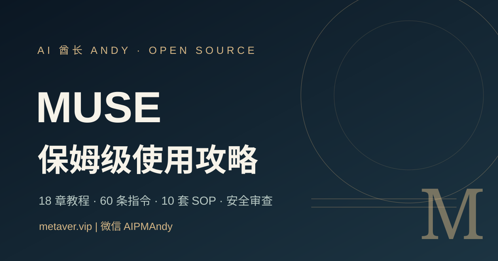

# Muse 保姆级使用攻略 · Muse Atlas 中文开源手册

> **一套可验证、能更新、带风险边界的 Meta Muse 个人 AI Agent 中文实战知识库。**  
> 版本 `v3.0.0` · 内容核查 `2026-10-21` · 独立编辑项目，**非 Meta 官方**。

**作者 AI 酋长 Andy** · 微信 **`AIPMAndy`** · 官网 **[metaver.vip](https://metaver.vip/)** · [求职咨询 / AI 陪跑](https://metaver.vip/services)

[](https://aipmandy.github.io/muse-guide/)

**[交互式网站](https://aipmandy.github.io/muse-guide/)** · [7 天入门](START-HERE.md) · [安全与隐私](docs/SECURITY.md) · [资料来源](docs/SOURCES.md) · [贡献指南](CONTRIBUTING.md)

> **使用前确认**：本教程针对 Meta 2026 年推出的 **Muse 个人 Agent**，不是 Muse Code 编码助手，也不是 Muse Wonder 模型 API。不同地区、设备、账号和版本可能存在功能差异。本项目不提供非官方绕过限制的安装与授权方法。

## 项目有什么

| 板块 | 数量 | 作用 |
|:--|--:|:--|
| 深度实战章节 | **28 章** | 从首次上手到安全、系统评估、运营维护 |
| 场景化任务指令 | **80 条** | 16 类 × 每类 5 条，复制后替换真实参数 |
| 业务 SOP | **12 套** | 输入、执行链、审批边界、验收指标 |
| 30 天训练计划 | **30 项** | 用真实实践构建自己的任务库，可打卡/导出 |
| 安全检查 | **12 项** | 授权、注入、共享、写入、回滚、误操作应急 |
| FAQ | **12 项** | 区分已经公开的官方能力与账户实际开放 |
| 在线任务书生成器 | **1 个** | 浏览器本地运行，无后端，不采集输入 |
| 开箱即用模板 | **8 套** | 任务书、授权矩阵、证据台账、内容与求职、客户交付、应急、ROI |

## 从哪开始

1. 阅读 **[START-HERE.md](START-HERE.md)**，完成一个不用连接私人账户的只读任务。
2. 从 [28 章目录](#完整课程地图) 挑选当前目标。
3. 打开[在线指令库](https://aipmandy.github.io/muse-guide/#library)，搜索并复制提示词。
4. 对照 [安全指南](docs/SECURITY.md) 检查真实授权。
5. 用 [30 天实践计划](PLAN-30-DAYS.md) 留存证据和复盘结果。

## 完整课程地图

| 章节 | 内容 | 章节 | 内容 |
|---|---|---|---|
| 01 | [官方入口与零基础](guides/01-get-started.md) | 10 | [一人公司与客户交付](guides/10-small-business.md) |
| 02 | [地区与功能矩阵](guides/02-availability.md) | 11 | [预约、采购与客服](guides/11-commerce-booking.md) |
| 03 | [六段式任务书](guides/03-task-spec.md) | 12 | [长期任务与主动建议](guides/12-recurring-goals.md) |
| 04 | [连接器与最小权限](guides/04-connectors.md) | 13 | [错误排障决策树](guides/13-troubleshooting.md) |
| 05 | [深度研究与反证](guides/05-web-research.md) | 14 | [定价、额度与 ROI](guides/14-pricing-value.md) |
| 06 | [邮件与日历](guides/06-email-calendar.md) | 15 | [安全、隐私与提示词注入](guides/15-safety-injection.md) |
| 07 | [文件、笔记与数据](guides/07-files-notes.md) | 16 | [评测与质量量化](guides/16-evaluation.md) |
| 08 | [AI+IP 内容生产](guides/08-content-ip.md) | 17 | [Muse Agent / Code / 模型区别](guides/17-muse-ecosystem.md) |
| 09 | [求职与面试](guides/09-job-hunting.md) | 18 | [更新机制与社区维护](guides/18-operations.md) |

## 开箱即用模板

- [Agent任务书](templates/agent-task-brief.md)
- [连接器授权矩阵](templates/permission-matrix.md)
- [调研证据台账](templates/source-evidence.md)
- [AI+IP内容SOP](templates/content-ip-sop.md)
- [求职匹配台账](templates/job-search-tracker.md)
- [客户交付SOP](templates/business-delivery.md)
- [误操作应急报告](templates/incident-response.md)
- [订阅ROI评分表](templates/roi-scorecard.md)

详细的[覆盖矩阵](docs/COVERAGE.md)、[真实测试协议](docs/BENCHMARK.md)、[对抗式审核](docs/AUDIT.md)和[待完成路线图](docs/ROADMAP.md)同样公开。

## 官方功能深度专题（2026-10-21 核查）

- [19｜官方下载安装到首个任务](guides/19-official-install.md)
- [20｜WhatsApp 与跨设备协作](guides/20-whatsapp-cross-device.md)
- [21｜Mac 桌面版文件与日历实操](guides/21-mac-desktop.md)
- [22｜购物、比价、Marketplace 与退货](guides/22-shopping-marketplace.md)
- [23｜财务、订阅费用与省钱任务](guides/23-personal-finance.md)
- [24｜健身、营养与健康场景](guides/24-fitness-coaching.md)
- [25｜后台任务、提醒与长期目标](guides/25-proactive-reminders.md)
- [26｜Muse for Small Business 经营实操](guides/26-small-business-skills.md)
- [27｜文档、图片生成与可交付结果](guides/27-documents-images.md)
- [28｜活动日志、审批与撤销权限](guides/28-permissions-audit.md)

新增的[官方功能证据矩阵](docs/OFFICIAL-ABILITY-MAP.md)采用官方发布（O）与真实账户复现（T）双轨记录，避免误导。已查阅官方设备、生产力、购物、财务、运动和经营页面，但暂无跨设备 Muse 登录实测数据。

## 2026 年 10 月的重要安全提醒

- **官方设计**：Meta 介绍了 Muse Secure VM、连接器及安全架构，但同时承认 Agent 仍可能出错；这些是官方陈述，不代表任何配置零风险。[Meta 安全文章](https://research.meta.ai/blog/security-and-safety-for-ai-agents-our-approach-with-muse)
- **独立报道**：2026-10-20 UTC，The Verge 报道研究人员发现 Muse 的聊天分享链接存在可被发现的问题；Meta 表示已经暂停该分享功能并展开评估。[The Verge 原文](https://www.theverge.com/tech/1014627/meta-muse-ai-sharing-ai-chats)
- **外部操作**：AP 2026 年 10 月报道的 Marketplace 案例涉及因授权设置导致地址意外分享。不要只相信 Agent 的文字承诺，必须审查应用权限和真实外部状态。[AP 原文](https://apnews.com/article/449734d41d3750aad7038b761faa49c9)

## 站点功能与隐私

- 内容通过本仓库的 `data/library.json` 提供，不依赖第三方 JS/CDN 或跟踪代码。
- 筛选、收藏、提示词复制、任务书生成、安全检查、30 天进度均在浏览器本地运行；需要下载进度时由你主动导出。
- 清除浏览器数据、换设备或无痕窗口会丢失本地进度。
- 请不要在公开仓库 Issue、本站任务生成器或未评估的 Agent 中输入秘密、验证码、客户个人信息。

## 本地预览与检查

```bash
python3 -m http.server 8000
# 浏览器打开 http://localhost:8000/
python3 -m unittest discover -s tests -v
```

推送到 `main` 后 GitHub Actions 执行检查和 Pages 发布。[部署说明](docs/DEPLOY.md)

## 社区质量标准

**任何涉及功能/地区/价格/连接器的修改，必须同时提供：证据链接、原文日期、核验日期、适用前提、是否真实账户验证、反证与安全影响。**  
欢迎真实问题、复现失败、独立审查和 PR；请勿上传私人的聊天记录与账号 Token。[如何贡献](CONTRIBUTING.md)

原始编写与编辑性内容 MIT License；Meta 的名称、商标和产品权益归其权利人。本站不是官方、没有代为登录或售卖 Muse 账号。

---

<!-- andy-author-card:start -->
## 作者 / About the author

**AI 酋长 Andy（Andy Liu，GitHub/X @AIPMAndy）**：前腾讯/百度 AI 产品专家，大模型独角兽前 VP，现专注 AI + 产品方法论创业。

可以找我聊求职咨询、AI 增长和副业陪跑，服务范围和费用先沟通确认。详见 [咨询与 AI 陪跑](https://metaver.vip/services)。

微信 `AIPMAndy`（备注「Muse 攻略」）· [X @AIPMAndy](https://x.com/AIPMAndy) · [Telegram @AIPMAndy](https://t.me/AIPMAndy) · [个人官网 metaver.vip](https://metaver.vip/) · [Grok Bot 中文攻略](https://aipmandy.github.io/grok-bot-handbook/)

*AI Chief Andy (Andy Liu, @AIPMAndy on GitHub and X) is a former Tencent and Baidu AI product expert and former VP at an LLM unicorn, now a serial entrepreneur focused on AI and product methodology.*

### 作者的其他项目

- [Grok Bot 中文攻略](https://github.com/AIPMAndy/grok-bot-handbook)：Grok Bot / AI Agent 中文教程，26 章加 40 套任务指令
- [AndySoul](https://github.com/AIPMAndy/AndySoul)：CLAUDE.md / AGENTS.md 规则模板，让 Claude Code、Codex、Cursor 少犯错
- [DNA Memory](https://github.com/AIPMAndy/dna-memory)：Claude Code、Codex 共用的本地 AI Agent 记忆 MCP
- [一个人靠 AI 赚钱](https://github.com/AIPMAndy/one-person-ai-income-guide)：验证需求、第一笔收款、交付与复购，附 30 天计划

<!-- andy-author-card:end -->
